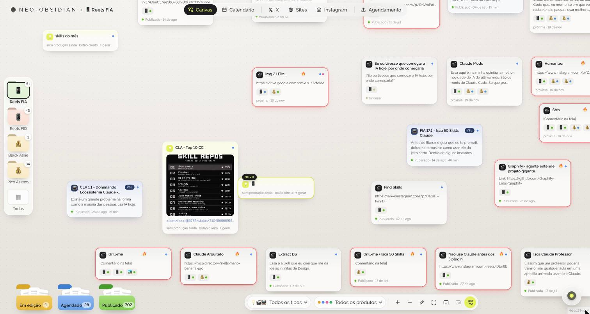
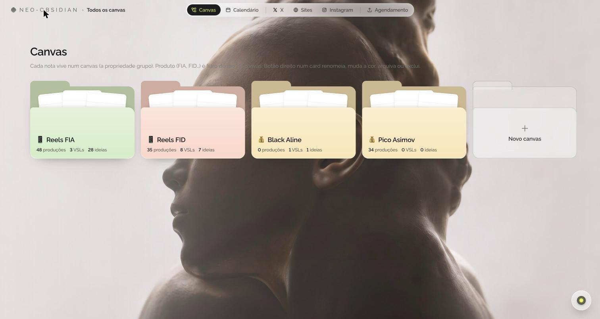
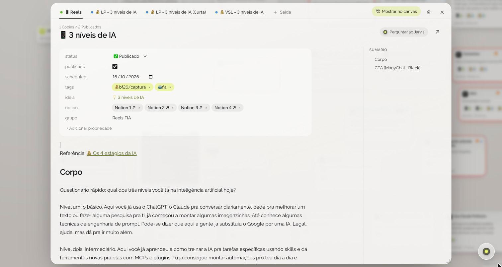
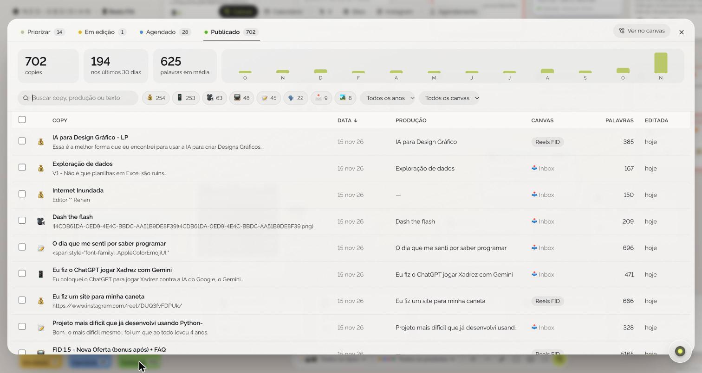

<div align="center">


# Neo-Obsidian

**Suas notas do Obsidian num canvas. Da ideia ao post publicado.**

Um app local que roda por cima do seu vault: cada ideia vira um card, cada card junta<br>
todas as versões dela (Reels, anúncio, carrossel, VSL) e o Claude trabalha no chat ao lado.

<br>


<br>



</div>

<br>

## O problema

Quem produz conteúdo todo dia no Obsidian conhece a cena. Uma ideia boa aparece. Ela vira um roteiro de Reels. O Reels funciona, então vira um anúncio. O anúncio vira uma landing page, um carrossel, um trecho de VSL. Cada versão é uma nota, e cada nota mora numa pasta diferente.

Duas semanas depois ninguém lembra:

- qual anúncio saiu de qual Reels;
- o que já foi publicado e o que ficou parado em edição;
- quais ideias ainda nem viraram nada.

O Obsidian é ótimo para **escrever** uma nota. Ele não foi feito para **enxergar o funil** de produção: as notas são uma lista de arquivos, as ligações viram um grafo bonito mas inútil para decidir o que gravar amanhã, e o Canvas nativo é um quadro que você tem que montar e manter à mão.

## A solução

O Neo-Obsidian **não substitui o vault**. Ele lê e escreve os mesmos arquivos `.md`, do mesmo jeito que você já usa. Se fechar o app e abrir o Obsidian, está tudo lá, sem nenhum formato novo.

O que ele faz é montar, a partir dessas notas, a vista que falta:

- **A ideia é o centro.** Toda copy que tem `ideia: "[[💡 Nome]]"` no frontmatter se pendura no card daquela ideia. Um clique e você vê o Reels, o anúncio e a LP lado a lado, cada um com seu status.
- **O status é o do vault.** A pasta e o emoji no nome do arquivo dizem onde a copy está (Priorizar, em edição, 🔹 agendada, ✅ publicada). Mudar o status no app move e renomeia o arquivo, e os `[[links]]` acompanham.
- **O canvas se monta sozinho.** Você não arrasta nada para começar: as notas com `grupo:` aparecem no canvas daquele tema já agrupadas. Arrastar só serve para organizar do seu jeito, e a posição fica guardada.
- **O Claude está do lado, dentro do vault.** O chat (o Jarvis) é uma sessão do Claude Code rodando no seu vault, com o seu `CLAUDE.md` e as suas skills. Ele escreve a próxima versão direto na nota, cria ideias, move cards e mostra coisas na sua tela.

```
 link, vídeo, texto ─▶ 💡 ideia ─▶ 🎬 versões (uma por formato)
                          │          📱 Reels · 💰 Ad · 🏞️ Carrossel · 📺 VSL
                          │                │
                          │                ▼  status = pasta + emoji no nome
                          │     Priorizar ─▶ Em edição ─▶ 🔹 Agendado ─▶ ✅ Publicado
                          ▼
                radar (X, GitHub, Hugging Face, HN) ─▶ 👍 / 👎 ─▶ vira 💡 ideia
```

## Um passeio pelo app

### Os canvas



Um **canvas** é um tema de trabalho (Reels de um produto, uma campanha, uma Black Friday). Cada nota vive em um canvas pela propriedade `grupo:`. A página inicial mostra uma pasta por canvas com a contagem de produções, VSLs e ideias. Botão direito numa pasta renomeia, troca a cor ou o ícone, arquiva ou exclui; arrastar muda a ordem.

Dentro de um canvas, as pastas de todos os canvas ficam na esquerda para você trocar de um para outro sem voltar ao início.

### O canvas por dentro

- **Cards de ideia** (💡), de **produção** (o grupo das versões, com um chip por formato) e de **VSL**.
- **Produtos** (FIA, FID, PICO…) são as tags da nota. No canvas eles viram filtro e uma bolinha colorida no card. Botão direito num card → **Produto ›** marca ou desmarca, e **＋ Novo produto** cadastra um produto novo ali mesmo (`🎓 Nome` usa o emoji como ícone).
- **Pastas de status** embaixo (Em edição, Agendado, Publicado) abrem uma tabela com aquelas copies.
- **Desenho livre:** um Excalidraw de verdade por baixo dos cards, com o mesmo zoom e posição. Bom para riscar setas, agrupar à mão, anotar.
- **Cole um link ou texto** no canvas e ele vira uma 💡 ideia com o material dentro (a transcrição do YouTube, o texto da página, o post do X).

### A nota



Clicar num card abre a nota por cima do canvas, no jeito do Notion:

- **Uma aba por versão** da mesma ideia. **＋ Saída** cria o próximo formato e pede ao Jarvis para escrevê-lo.
- **Propriedades editáveis** como no Obsidian: tags em chips, datas com calendário, `publicado` em caixinha. Cada mudança reescreve só a linha daquela chave.
- **Editor como o do Obsidian** (CodeMirror 6, live preview): títulos, negrito, callouts, tarefas e `[[wikilinks]]` formatados, com as marcas aparecendo só na linha do cursor. Salva sozinho e, se o arquivo mudou no Obsidian, avisa em vez de sobrescrever.
- **Sumário** dos títulos na direita, para pular para um bloco.
- Arraste uma borda para mudar o tamanho da nota; duplo clique volta ao padrão.

### As tabelas



As pastas de status abrem uma tabela com os números do período, barras por mês, filtros por formato, ano e canvas, busca no texto e ordenação. Clique numa linha para abrir a copy; o "voltar" da nota retorna para a tabela.

### O resto

- **Jarvis (⌘J):** o chat do Claude. Clique no balão de um card ou aperte `⌘I` numa nota para mandar a nota (ou o trecho selecionado) como contexto. Também dá para **ditar**: o 🎤 do campo (ou `⌘⇧D`) transcreve a sua voz em pt-BR enquanto você fala.
- **Radar (X e Sites):** posts do X, GitHub Trending, Hugging Face e Hacker News em cards. 👍 ensina o ranking, 👎 tira do feed, 💡 transforma o card em ideia no canvas.
- **Calendário** pelo `scheduled` das copies (arraste para reagendar) e **Agendamento** com os posts do Instagram via Metricool.
- **Busca rápida (⌘P ou ⌘O):** começa pelas últimas notas que você abriu. Escolher uma leva você para o canvas dela (se ela estiver num canvas ativo) antes de abrir.

## Atalhos

| Atalho | O quê |
|---|---|
| `⌘P` / `⌘O` | Buscar e abrir qualquer nota (as últimas abertas aparecem primeiro) |
| `⌘1` … `⌘7` | Trocar de página (Canvas, Calendário, X…) |
| `⌘1` com uma nota aberta | Ir para a 💡 ideia da nota |
| `⌘2`, `⌘3`… com uma nota aberta | Ir para a 1ª, 2ª… versão da ideia (as abas de cima) |
| `⌘J` | Mostrar ou esconder o Jarvis |
| `⌘I` | Mandar a nota (ou o trecho selecionado) ao Jarvis |
| `⌘⇧D` | Ditar a mensagem no chat |
| `⌘S` | Salvar agora (ele já salva sozinho 1 s depois de você parar de digitar) |
| `⌘⌫` | Mandar a nota aberta para a lixeira do vault (com confirmação) |
| `⌘` + clique | Abrir um `[[link]]` |
| `W` | Modo de trabalho: esconde a barra de cima e a de baixo, o Jarvis ocupa a altura toda |
| `F` | Modo foco |
| `E` | Liga e desliga o desenho livre |
| botão direito no canvas | Nova ideia, colar como ideia, nova copy; num card: Mover para ›, Produto ›, winner 🔥 |

## Instalação

**Você precisa de:** macOS, [uv](https://docs.astral.sh/uv/) com Python 3.12+, Node 20+, um vault do [Obsidian](https://obsidian.md/) e o [Claude Code](https://claude.com/claude-code) logado. O chat usa a sua assinatura do Claude, não uma chave de API.

```bash
git clone https://github.com/rtadewald/neo-obsidian.git
cd neo-obsidian

# o front (Vite + React)
npm --prefix app/frontend install

# o caminho do seu vault
$EDITOR app/backend/src/jarvis/config.py      # VAULT = Path("/caminho/do/seu/vault")

# um comando para subir tudo
ln -s "$PWD/app/neo-obsidian.sh" ~/.local/bin/neo-obsidian
neo-obsidian
```

O `neo-obsidian` sobe a API (porta 8740) e o front (porta 5180) e abre o navegador. `Ctrl+C` derruba os dois.

| Comando | O quê |
|---|---|
| `neo-obsidian` | Sobe API + front e abre o app |
| `neo-obsidian parar` | Derruba o que estiver rodando nas portas do app |
| `neo-obsidian abrir` | Só abre o navegador |

**O que o app espera do vault:** as copies em `1 Copies/` (`0 Ideias`, `1 Priorizar`, `2 Publicados`) e as skills em `3 Skills/<nome>/SKILL.md`. As propriedades que ele usa são `ideia`, `grupo`, `tags`, `scheduled` e `publicado`, todas comuns de frontmatter: se você parar de usar o app, elas continuam fazendo sentido no Obsidian.

## Como é feito

```
app/
  neo-obsidian.sh       o comando: sobe API + front, para e abre
  backend/src/jarvis/   FastAPI (uv run jarvis, porta 8740)
    main.py             as rotas
    canvas.py           ideias, produções, canvas, produtos e posições
    notas.py            ler, salvar, mover, renomear e mandar para a lixeira (com os links)
    agente.py           o chat: uma sessão do Claude Code dentro do vault
    radar.py · preferencias.py · coletores/   o radar e o ranking pelos seus votos
    metricool.py · anuncios.py               posts, agendados e Meta Ads (leitura)
  frontend/src/         Vite + React 19 + React Flow 12 + CodeMirror 6
    Canvas.tsx · Canvases.tsx   o canvas e a página inicial
    ModalNota.tsx · Editor.tsx · livePreview.ts · propriedades.ts · Sumario.tsx   a nota
    Tabela.tsx · Radar.tsx · Chat.tsx · Paleta.tsx · CalendarioEditorial.tsx
  dados/                SQLite do radar, posições do canvas, produtos, miniaturas (fora do git)
specs.md                decisões e escopo
```

Tudo roda na sua máquina. O app só fala com o seu vault, com o Claude Code (pela sua conta) e, se você usar, com o Metricool e as fontes públicas do radar.

## Próximos passos

- [x] Ideia e entrada viraram uma coisa só: tudo é 💡 ideia.
- [x] Propriedades editáveis no card, como no Obsidian.
- [x] Ditado no chat.
- [ ] Retreinar o ranking do radar a partir dos Curtidos.
- [ ] Caminho do vault configurável pela interface.

<br>

<div align="center">
<sub>Feito por <a href="https://github.com/rtadewald">Rodrigo Tadewald</a> com <a href="https://claude.com/claude-code">Claude Code</a> · sobre um vault do <a href="https://obsidian.md/">Obsidian</a></sub>
</div>
